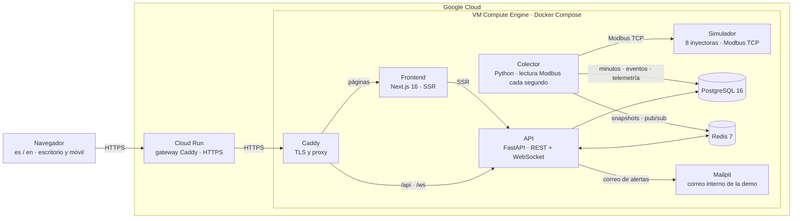

# OEE Live · Proyecto final del bootcamp

<p align="center">
  
  
  
  
</p>

**Demo en línea:** https://oee-live-keepcoding.cloud.run
**Tablero público sin cuenta:** https://oee-live-keepcoding.cloud.run/es/plants/planta-demo-slp

> **Summary (EN).** OEE Live is a SaaS for small and mid-size plants that have no MES: it reads
> injection machines over Modbus TCP, shows their state in real time and computes Availability,
> Performance, Quality and OEE per machine, shift and plant, with alerts, downtime classification,
> production runs and formatted Excel reports. Next.js 16 frontend, FastAPI backend, PostgreSQL,
> Redis, a Modbus simulator and a collector, deployed on Google Cloud (VM + Cloud Run gateway).
> The online demo stays available for one week after delivery; afterwards, see *Ejecutarlo en
> localhost* below.

---

## 1. Objetivo de la aplicación

En una planta de inyección de plástico cada máquina sabe cuántos disparos dio, cuántas piezas
buenas produjo, cuánto tiempo estuvo en falla y qué código de alarma tuvo. Casi nadie lo lee: esa
información se queda en el PLC. OEE Live la conecta, la guarda y la convierte en el indicador que
usa toda la industria para medir una máquina: el **OEE**.

```
OEE = Disponibilidad × Rendimiento × Calidad
Disponibilidad = tiempo en marcha ÷ tiempo planificado
Rendimiento    = tiempo ideal ÷ tiempo en marcha   (tiempo ideal = piezas × estándar por pieza)
Calidad        = piezas buenas ÷ (buenas + rechazos)
```

Lo que resuelve, en orden de uso:

1. **Conectar** cada máquina por Modbus TCP (host, puerto, unit id) y leerla cada segundo.
2. **Ver** el plano de la planta con cada máquina teñida por su estado (en marcha, inactiva, falla,
   sin conexión), su OEE del día y su corrida vigente; una línea de tiempo de 8 horas por máquina.
3. **Clasificar** los paros con un motivo y un comentario, y saber quién lo hizo.
4. **Avisar** cuando una máquina cae, se desconecta o su OEE baja del umbral: en vivo por
   WebSocket y por correo si la persona no está conectada.
5. **Consultar** por rango y máquinas, y descargar un Excel con formato o el CSV.
6. **Compartir** un tablero público para quien no tiene cuenta, con SEO y URL amigable.

La demo simula una planta real de ocho inyectoras (cavidades 1, 2 y 4) con siete días de histórico
y producción continua: todo lo que se ve se está escribiendo en la base de datos en ese momento.

---

## 2. Para los profesores: cómo entrar y qué mirar

### Acceso

| Qué | Dónde |
|---|---|
| Aplicación | https://oee-live-keepcoding.cloud.run |
| Usuario de consulta (solo lectura) | usuario `demo` · contraseña `Demo1234!` (también aparece en la portada) |
| Tablero público sin cuenta | https://oee-live-keepcoding.cloud.run/es/plants/planta-demo-slp |
| Idiomas | selector es / en en la cabecera |
| Documentación del API | `https://oee-live-keepcoding.cloud.run/api/v1/docs` |

La cuenta `demo` es **operador**: ve tableros, históricos, paros y datos, recibe notificaciones y
sigue máquinas, pero no cambia la configuración. Las cuentas de propietario y supervisor existen y se
usan en el recorrido de pruebas; si se necesita una para la evaluación, se entrega aparte.

La demo en línea permanece **una semana** después de la entrega. Si ya no responde, el proyecto se
levanta completo en localhost con Docker en unos minutos (sección 7).

### Recorrido sugerido (5 minutos)

1. **Portada**: acceso, instrucciones y guía de uso en cuatro pasos.
2. **Tablero** de la planta: plano de piso con las ocho máquinas, totales por estado y OEE del día.
   Botón *Tarjetas* para la vista clásica y *Pantalla completa* para la pantalla de piso.
3. **Máquina** (clic en cualquiera): línea de tiempo de 8 h con tooltip (motivo del paro y quién lo
   clasificó), OEE de hoy, contadores del equipo (disparos, piezas, último ciclo), corrida vigente
   (producto, molde, resina, cavidades), variables de proceso en vivo, tendencia y eventos paginados.
4. **Paros**: fallas e inactividad de todas las máquinas con motivo, comentario y quién clasificó,
   más los paros de línea abiertos y su histórico.
5. **Datos**: rango, máquinas y vista (por máquina, por día, día × máquina). *Descargar Excel*
   genera un libro con portada, indicadores, tablas con semáforo y hoja de cálculo explicada.
6. **Campana** de la cabecera: las notificaciones reales (OEE bajo umbral, falla prolongada) se leen
   ahí mismo y llevan a la máquina. **Seguimiento**: máquinas favoritas con alertas.
7. **Configuración** (propietario o supervisor): catálogos de inyección, turnos, personal, reglas de
   alerta y ajustes de la planta.

### Limitaciones conocidas

- El correo de la demo se captura en un buzón interno (Mailpit); no sale a direcciones reales.
  La pantalla de recuperación de contraseña lo avisa.
- La entrada por Cloud Run arranca en frío si lleva un rato sin visitas: la primera petición puede
  tardar unos segundos.
- El endpoint CSV del servidor (`/reports/oee.csv`) recalcula cada máquina y día y tarda decenas
  de segundos; la pantalla de Datos ya no depende de él y genera el CSV en el navegador con las
  mismas columnas.

---

## 3. Recorrido con imágenes reales

Capturas tomadas de la demo en línea con la cuenta de consulta. Cada imagen corresponde a un
módulo; debajo se explica qué se observa y de dónde sale el dato.

### Portada y acceso


La puerta de entrada. A la izquierda el formulario de acceso con la cuenta de demostración al
pie; a la derecha, los cuatro pasos para seguir una planta y el enlace al tablero público. El
fondo es una nave de inyección real.

### Tablero público (sin cuenta)


Lo que ve cualquiera con el enlace: OEE de la planta hoy con sus tres factores, cuántas máquinas
hay en cada estado y una tarjeta por máquina con estado, tiempo en ese estado, OEE, A/P/Q y
contadores. Se actualiza por WebSocket; la página se renderiza en servidor para SEO.

### Mis plantas


Las plantas a las que pertenece la cuenta, con el puesto en cada una y su OEE del día. La guía
de uso se repite aquí para quien entra por primera vez.

### Tablero de planta: plano de piso


La pantalla principal. Arriba, el conteo de máquinas por estado y el OEE de la planta con sus
tres factores; si hay paros de línea activos aparece una franja roja. Después, una ficha por
máquina agrupada por línea de producción: barra de estado (verde en marcha, ámbar inactiva, roja
falla, gris sin conexión), silueta de la inyectora teñida con ese estado, nombre y modelo, OEE
del día en grande con el semáforo, barras de disponibilidad, rendimiento y calidad, y la corrida
vigente (producto · molde · cavidades activas/nominales). Al pie, la franja de la práctica con el
reloj de la planta y cuántas máquinas tienen orden abierta.

### Tablero de planta: tarjetas


La misma información en tarjetas con anillo de OEE, pensada para pantallas de piso.

### Detalle de máquina


De arriba abajo: estado actual y acciones (seguir, histórico); línea de tiempo de las últimas
8 horas con un segmento por estado (al pasar el cursor muestra motivo, comentario y quién
clasificó el paro; con permisos, clic para clasificar); OEE de hoy con A, P y Q; contadores del
equipo (disparos, piezas buenas, rechazos, último ciclo real por disparo y estándar base por
pieza); la corrida vigente con producto, molde, resina, cavidades, ciclo por disparo e ideal por
pieza; variables de proceso leídas por Modbus con su calidad de dato y la tendencia del ciclo; la
tendencia de OEE por hora, turno o día, y la tabla de eventos paginada.

### Paros


Fallas (con código de alarma del equipo) e inactividad (sin ciclar) de todas las máquinas en el
rango elegido, con motivo, comentario y quién lo clasificó; el botón *Clasificar* abre el diálogo
con el catálogo de motivos. Debajo, los paros de línea abiertos manualmente y su histórico. Ambos
tipos restan disponibilidad en el OEE.

### Datos


Rango con atajos (hoy, 7 días, 30 días), selección de máquinas y tres vistas: por máquina, por
día y día × máquina. El resumen del rango, la tabla con semáforo y la gráfica salen de los mismos
datos que el CSV y el Excel. El Excel trae portada, indicadores, tablas con semáforo y una hoja
que explica el cálculo.

### Producción


Órdenes de producción y corridas por máquina: al abrir una corrida se congelan producto, molde,
resina y cavidades, y desde ahí sale el estándar por pieza que usa el OEE. La trazabilidad muestra
los lotes de resina consumidos y el personal asignado.

### Configuración


Todo lo que se configura una vez: líneas, productos, moldes, resinas, recetas y lotes; turnos;
personal y puestos; reglas de alerta; ajustes de la planta. Solo el propietario o un supervisor
editan; el operador consulta.

### Notificaciones y seguimiento


Las reglas de alerta (máquina con falla más de N segundos, sin conexión, OEE bajo el umbral)
generan notificaciones reales que llegan por WebSocket y se leen desde la campana sin cambiar de
pantalla; por correo si la persona no está conectada. *Seguimiento* lista las máquinas favoritas.

### Histórico de telemetría


Variables de proceso por rango (1 h, 8 h, 24 h, 7 días o fechas), con promedio, mínimo y máximo
por intervalo, calidad del dato y la corrida a la que pertenece cada muestra.

### Móvil


Toda la aplicación es responsive; en el teléfono la zona privada usa una barra de navegación
inferior.

---

## 4. Arquitectura general



Tres procesos de Python comparten modelos y servicios: la **API** (REST + WebSocket), el
**colector** y el **simulador**. El colector es un único proceso (`python -m app.collector`,
cuatro módulos dentro del paquete del backend) que cada segundo lee las ocho máquinas en paralelo
con pymodbus, convierte disparos en piezas según las cavidades activas, escribe minutos, eventos y
telemetría por lotes en PostgreSQL, publica el snapshot de cada máquina en Redis y evalúa las
reglas de alerta. El simulador es otro proceso con un servidor Modbus TCP y una máquina de estados
por inyectora, reproducible por semilla; en una planta real se sustituye por los equipos. El frontend es un servidor Next.js que renderiza la zona pública en servidor y consume
la API desde el navegador con un WebSocket por sesión. Todo corre en contenedores definidos en
Compose, con una capa extra de archivos para la demo y para la entrada por Cloud Run.

---

### Modelo de datos (entidad–relación)

Treinta y una tablas en PostgreSQL, agrupadas por lo que representan. Solo las entidades
centrales muestran sus columnas; el resto aparece con sus relaciones.

```mermaid
erDiagram
  %% Cuentas y acceso
  users ||--o{ plant_members : "pertenece a"
  plants ||--o{ plant_members : "tiene personal"
  users ||--o{ refresh_tokens : "sesiones"
  users ||--o{ password_reset_tokens : "recuperaciones"

  %% Planta y máquinas
  plants ||--o{ shifts : "turnos"
  plants ||--o{ production_lines : "líneas"
  plants ||--o{ machines : "máquinas"
  production_lines |o--o{ machines : "agrupa"
  machines ||--o| machine_board_positions : "posición en el plano"
  machines ||--o{ machine_variables : "tags Modbus"

  %% Captura del colector
  machines ||--o{ production_minutes : "minutos"
  machines ||--o{ production_samples : "muestras"
  machines ||--|| machine_checkpoints : "contadores absolutos"
  machines ||--o{ machine_events : "estados y paros"
  machines ||--o{ machine_telemetry : "telemetría"
  downtime_reasons |o--o{ machine_events : "motivo"
  users |o--o{ machine_events : "clasificó"

  %% Inyección: catálogos, órdenes y corridas
  plants ||--o{ products : "catálogo"
  plants ||--o{ molds : "catálogo"
  plants ||--o{ resins : "catálogo"
  plants ||--o{ employees : "personal de piso"
  users |o--o| employees : "cuenta opcional"
  products ||--o{ injection_recipes : "receta"
  molds ||--o{ injection_recipes : "receta"
  resins ||--o{ injection_recipes : "receta"
  resins ||--o{ resin_lots : "lotes"
  injection_recipes ||--o{ production_orders : "órdenes"
  production_orders ||--o{ production_runs : "corridas"
  machines ||--o{ production_runs : "corre en"
  molds ||--o{ production_runs : "molde montado"
  production_runs |o--o{ machine_telemetry : "contexto de la muestra"
  production_runs ||--o{ run_materials : "materiales"
  resin_lots ||--o{ run_materials : "lote consumido"
  production_runs ||--o{ run_employees : "personal asignado"
  employees ||--o{ run_employees : "asignación"
  production_lines ||--o{ line_downtimes : "paros de línea"
  downtime_reasons |o--o{ line_downtimes : "motivo"
  line_downtimes ||--o{ line_downtime_machines : "afecta a"
  machines ||--o{ line_downtime_machines : "afectada"

  %% Alertas, notificaciones y seguimiento
  plants ||--o{ alert_rules : "reglas"
  machines |o--o{ alert_rules : "regla por máquina"
  users ||--o{ notifications : "recibe"
  users ||--o{ watchlist : "sigue"
  machines ||--o{ watchlist : "seguida por"

  users {
    int id PK
    string username
    string email
    string full_name
    string password_hash
    string language
  }
  plants {
    int id PK
    string slug
    string name
    string timezone
    bool is_public
  }
  plant_members {
    int plant_id PK, FK
    int user_id PK, FK
    string role
  }
  shifts {
    int id PK
    int plant_id FK
    string name
    time start_time
    time end_time
    string days_of_week
  }
  machines {
    int id PK
    int plant_id FK
    int line_id FK
    string name
    string host
    int port
    int unit_id
    float ideal_cycle_s
    bool is_active
  }
  machine_variables {
    int id PK
    int machine_id FK
    string code
    int address
    string data_type
    float scale
    float offset
  }
  production_minutes {
    int machine_id PK, FK
    datetime bucket_start PK
    int good
    int reject
    float run_s
    float idle_s
    float down_s
    float offline_s
  }
  machine_events {
    int id PK
    int machine_id FK
    string state
    string reason_code FK
    string comment
    int classified_by FK
    datetime started_at
    datetime ended_at
  }
  machine_telemetry {
    int machine_id PK, FK
    datetime sampled_at PK
    int run_id FK
    json values
  }
  injection_recipes {
    int id PK
    int product_id FK
    int mold_id FK
    int resin_id FK
    float ideal_cycle_s
    int active_cavities
  }
  production_runs {
    int id PK
    int order_id FK
    int machine_id FK
    int mold_id FK
    json context
    int active_cavities
    float ideal_cycle_s
    datetime started_at
    datetime ended_at
  }
  alert_rules {
    int id PK
    int plant_id FK
    int machine_id FK
    string type
    float threshold
    int duration_s
    bool is_active
  }
  notifications {
    int id PK
    int user_id FK
    string type
    json payload
    datetime created_at
    datetime read_at
  }
```



Claves de lectura: el **colector** escribe en `production_minutes`, `production_samples`,
`machine_checkpoints`, `machine_events` y `machine_telemetry`; el **OEE** se calcula a partir
de los minutos, los turnos de la planta y el estándar de la corrida vigente (`production_runs`
congela cavidades y ciclo ideal); las **alertas** nacen de `alert_rules` y terminan en
`notifications` para cada usuario que sigue la máquina o pertenece a la planta.

### Tecnologías utilizadas

| Capa | Lenguaje | Frameworks y librerías | Herramientas |
|---|---|---|---|
| Frontend | TypeScript (modo estricto) | Next.js 16 (App Router, SSR), React 19, next-intl, TanStack Query, React Hook Form + zod, Tailwind CSS 4, Recharts, exceljs, MSW (mocks) | pnpm, ESLint, Prettier, Vitest, Playwright |
| Backend (API y colector) | Python 3.12 | FastAPI, SQLAlchemy 2 (asyncio) + asyncpg, Alembic, Pydantic, PyJWT, argon2, pymodbus, Pillow, redis | uv, Ruff, pytest, pytest-asyncio |
| Simulador | Python 3.12 | pymodbus (servidor Modbus TCP), FastAPI (control HTTP) | pytest |
| Datos | SQL | PostgreSQL 16, Redis 7 | pg_dump / pg_restore |
| Infraestructura | Bash, PowerShell, YAML | Docker, Docker Compose, Caddy 2, Google Cloud (Compute Engine, Cloud Run, Artifact Registry, IAP) | gcloud, scripts de aprovisionamiento, empaquetado y respaldo |
| Contrato y documentación | Markdown, OpenAPI | Especificación escrita y documentación OpenAPI generada por el API | Git y GitHub |

## 5. Arquitectura por partes

### 4.1 Servidor e infraestructura

| Pieza | Qué hace |
|---|---|
| VM `e2-medium` en GCP (Debian, Docker Engine, Compose) | Aloja todos los contenedores; IP fija; acceso por SSH mediante IAP, sin puertos abiertos salvo Caddy. |
| Caddy en la VM | TLS automático para el origen, proxy a API y frontend, filtra tokens y cookies de los registros. |
| Cloud Run `oee-live` | Entrada HTTPS pública de la demo; redirige las direcciones anteriores con 308 y fija las cabeceras de seguridad. |
| Releases inmutables | Un archivo `oee-release.tar.gz` con manifiesto SHA-256 por versión; en la VM cada release vive en `/opt/oee-live/releases/<fecha>`; se despliega con Compose y se conserva la anterior para revertir. |
| Respaldos | `pg_dump` verificado antes de cada despliegue, en `/opt/oee-live/backups`. |
| Secretos | Un único `.env.demo` con permisos de root 0600; nunca en el repositorio ni en los registros. |

Archivos: `docker-compose.prod.yml` (base), `docker-compose.demo.yml` (demo: Mailpit, límites de
log), `docker-compose.cloud-run.yml` (URLs públicas del gateway), `Caddyfile*`, `scripts/gcp/`
(aprovisionamiento, empaquetado, despliegue y respaldo) y `docs/gcp-deployment.md` (guía completa).

### 4.2 Base de datos

PostgreSQL 16 con migraciones Alembic (`backend/alembic`). Las tablas principales:

| Grupo | Tablas | Notas |
|---|---|---|
| Cuentas y acceso | `users`, `refresh_tokens`, `password_resets`, `plant_members` | Roles por planta: owner, supervisor, viewer. Refresh rotatorio con familia revocable. |
| Planta | `plants`, `shifts`, `machines`, `downtime_reasons` | Zona horaria IANA por planta; turnos de 8 h; foto de máquina en tres tamaños WebP. |
| Captura | `production_minutes`, `production_samples`, `machine_events`, `machine_checkpoints`, `telemetry_samples` | Deltas por minuto, un solo evento abierto por máquina (índice único parcial), contadores absolutos para sobrevivir caídas del colector, variables de proceso con calidad del dato. |
| Inyección | `production_lines`, `products`, `molds`, `resins`, `resin_lots`, `recipes`, `orders`, `production_runs`, `run_materials`, `run_assignments`, `line_downtimes` | Una corrida congela producto, molde, resina y cavidades; el OEE pondera cada minuto con el estándar de su corrida. |
| Alertas | `alert_rules`, `notifications`, `watchlist` | Reglas por máquina o por planta; deduplicación por destinatario; entrega en vivo o por correo. |

Todo se guarda en UTC; los cortes por día y por turno se calculan en la zona de la planta.

### 4.3 Backend (FastAPI, Python 3.12)

- **API REST** `/api/v1` con OpenAPI: auth (registro, login, refresh por cookie `HttpOnly`,
  recuperación de contraseña, perfil, baja), plantas y miembros, máquinas con foto, turnos,
  eventos y clasificación, OEE por hora/turno/día, resumen de planta, CSV, catálogos de
  inyección, órdenes y corridas con trazabilidad, paros de línea, variables y telemetría,
  tablero y plano, alertas, notificaciones y seguimiento.
- **WebSocket** privado por sesión (snapshots y notificaciones) y público por planta.
- **Colector**: un solo proceso de Python (`app/collector`: `runner.py`, `state.py`,
  `storage.py`, `health.py`) que lee las ocho máquinas por Modbus TCP cada segundo y en
  paralelo, convierte disparos en piezas según las cavidades activas, persiste minutos, eventos y
  telemetría por lotes, mantiene snapshots en Redis y evalúa las reglas de alerta. En una planta
  real se añaden máquinas por configuración, sin un script por máquina.
- **Cálculo de OEE** con reglas explícitas: excluye tiempo fuera de turno, une turnos solapados,
  limita el rendimiento a 100 %, devuelve `null` ante divisor cero y agrega la planta con
  acumulados, nunca promediando porcentajes.
- **Pruebas**: 227 pruebas automatizadas (unitarias y de API) más variantes opcionales contra
  PostgreSQL real.

Carpeta `backend/`: `app/api` (rutas), `app/services` (reglas de negocio), `app/models`
(SQLAlchemy), `app/schemas` (DTO), `app/collector`, `alembic/`, `tests/`.

### 4.4 Simulador Modbus

`simulator/` expone un servidor Modbus TCP con ocho máquinas y perfiles de producción, falla,
paro y rechazo reproducibles por semilla, más un pequeño control HTTP para forzar estados. Permite
probar el sistema completo sin una planta real y es lo que alimenta la demo.

### 4.5 Frontend (Next.js 16, TypeScript estricto)

- **Zona pública** con SEO: portada (acceso, instrucciones y guía), tablero de planta en vivo y
  detalle de máquina con URL amigable, metadatos, sitemap, hreflang y botones para compartir.
- **Zona privada** `/app`: mis plantas, tablero (plano o tarjetas), máquinas, producción, paros,
  datos, configuración, seguimiento, notificaciones y perfil.
- **Capas**: `lib/api` (cliente tipado del contrato, renovación de token única y concurrente),
  `lib/realtime` (WebSocket con reconexión, escritura directa en la caché), `lib/` (formato,
  zona horaria, validación zod, CSV, agregados, Excel), `components/` por módulo, `mocks/` (MSW
  con un motor de simulación propio para desarrollar sin backend).
- **Herramientas**: next-intl (es/en), TanStack Query, React Hook Form + zod, Tailwind 4,
  Recharts, exceljs (Excel con formato generado en el navegador), MSW, Vitest (68 pruebas) y un
  recorrido Playwright de 35 pasos.
- **Diseño**: sala de control industrial, tema oscuro y claro, responsive hasta 390 px,
  accesible (foco visible, diálogos nativos, nombres accesibles, navegación por teclado).

Detalle en [frontend/README.md](frontend/README.md).

---

## 6. Seguridad

Lo que un revisor puede comprobar desde fuera, verificado contra la demo en línea:

| Aspecto | Cómo está resuelto |
|---|---|
| Contraseñas | Hash Argon2; nunca se guardan ni se registran en claro. La comprobación usa un hash ficticio cuando el usuario no existe, para no revelar si existe. |
| Sesión | Access token JWT (HS256) de 15 minutos solo en memoria del navegador; refresh en cookie `HttpOnly`, `Secure`, `SameSite=Lax`, con ruta limitada a `/api/v1/auth` y rotación con familia revocable (reutilizar un refresh viejo invalida la cadena). Un token alterado responde 401. |
| Autorización | Toda ruta privada responde 401 sin sesión. Los permisos se verifican por planta: un recurso ajeno responde 404 (no se enumera) y un rol insuficiente 403. La cuenta de demo es operador: puede leer, no escribir. |
| Intentos de acceso | En el login, diez intentos por dirección y cincuenta por usuario en ventanas de diez minutos (429 al superarlos; acertar limpia el contador del usuario), diez registros por dirección y cinco solicitudes de recuperación de contraseña por dirección; los contadores viven en Redis. |
| CORS y cabeceras | CORS solo para el origen del frontend; un origen ajeno recibe 400 en el preflight. HSTS, `X-Frame-Options: SAMEORIGIN`, `X-Content-Type-Options: nosniff`, `Referrer-Policy: no-referrer`, `Permissions-Policy` sin cámara, micrófono ni ubicación, y sin cabecera `x-powered-by`. |
| Entradas | Validación con esquemas (Pydantic en el API, zod en el frontend). React escapa el HTML. El CSV protege las celdas que empiezan con `=`, `+`, `-` o `@` contra inyección de fórmulas. Las fotos se decodifican y se vuelven a codificar en WebP en tres tamaños: no se sirve el archivo original. |
| Registro y correo | Los enlaces de recuperación y de dejar de seguir llevan tokens firmados de un solo uso con caducidad; los tokens se guardan hasheados. El correo de la demo queda en un buzón interno. |
| Servidor | Solo Caddy publica puertos en la VM; PostgreSQL, Redis, Mailpit y el simulador son internos. Acceso administrativo por SSH mediante IAP, sin puertos abiertos. Secretos en un único archivo con permisos de root; nunca en el repositorio ni en los registros. El gateway excluye los registros automáticos de petición porque la URL del WebSocket lleva el token, y Caddy redacta tokens y cookies en los suyos. |
| Dependencias | `pnpm audit` sin avisos en producción tras fijar `uuid` a una versión corregida; backend con versiones bloqueadas en `uv.lock`. |

Límites conocidos, para decirlos antes de que los encuentren: no hay Content-Security-Policy
(Next y las gráficas usan estilos y scripts en línea; se dejó fuera para no romper la interfaz en la
entrega); la documentación OpenAPI es pública en `/api/v1/docs` a propósito, para la evaluación;
el token del WebSocket viaja en la URL, como fija la especificación, mitigado con la exclusión y
redacción de registros; y la cuenta `demo` es pública por diseño, con permisos de solo lectura.

---

## 7. Ejecutarlo en localhost

### Opción A · Todo con Docker (recomendada)

Requiere Docker Engine con Compose. Desde esta carpeta:

```sh
cp .env.example .env
docker compose up --build -d
docker compose exec api python -m app.seed
```

Levanta PostgreSQL, Redis, Mailpit, API, simulador, colector y frontend, aplica migraciones y crea
la planta de demostración. Cuenta local: usuario `demo`, contraseña `Demo1234!`.

| Servicio | Dirección |
|---|---|
| Aplicación | http://localhost:3000/es |
| API y OpenAPI | http://localhost:8000/api/v1/docs |
| Buzón de correo de desarrollo | http://localhost:8025 |
| Control del simulador | http://localhost:8100/machines |

### Opción B · Solo el frontend, sin backend

Requiere Node 20.9+ y pnpm 12. Los mocks (MSW) traen tres plantas, once máquinas, siete días de
histórico y simulación en vivo.

```sh
cd frontend
pnpm install
pnpm dev
```

Abre http://localhost:3000/es. Usuarios de prueba: `demo` / `Demo1234!` (propietario),
`lmendez` / `Super1234` (supervisora) y `cruiz` / `Viewer1234` (operador).

### Opción C · Backend sin contenedores

Python 3.12 y uv, con PostgreSQL, Redis y un SMTP de desarrollo accesibles según `.env`:

```sh
cd backend
uv sync --python 3.12
uv run alembic upgrade head
uv run python -m app.seed
uv run uvicorn app.main:app --host 127.0.0.1 --port 8000 --reload
uv run python -m app.collector      # en otra terminal
```

El simulador se arranca desde `simulator/` (ver su README). La referencia técnica completa de
configuración, variables y decisiones está en [docs/README-tecnico.md](docs/README-tecnico.md).

---

## 8. Qué reforcé con este bootcamp

Trabajo en la industria automotriz, donde desarrollé el MES de mi planta: captura de datos de
máquinas de inyección y ensamble, trazabilidad y tableros de producción. Hace dos años cursé el
bootcamp de Big Data en KeepCoding, y este lo elegí para reforzar desarrollo web: frontend, backend
y despliegue. Lo que me dejó, aplicado en este proyecto:

- **TDD y pruebas como parte del diseño.** Las reglas del OEE, el agregado de reportes, el
  parseo del CSV, el libro de Excel y el cliente de API nacieron con su prueba. 230 pruebas en el
  backend y 68 en el frontend, más un recorrido de extremo a extremo que ejecuto antes de cada
  entrega.
- **Arquitectura hexagonal, en la práctica.** Dominio y servicios separados de rutas y modelos en el
  backend; en el frontend, un cliente de API tipado y una capa de tiempo real desacoplados de los
  componentes, con mocks que implementan el mismo contrato para desarrollar sin servidor.
- **React avanzado.** App Router con renderizado en servidor y componentes cliente, caché y
  sincronización con TanStack Query, escritura de snapshots de WebSocket en la caché sin volver a
  pedir, formularios con React Hook Form y zod, internacionalización, accesibilidad y estados de
  interfaz explícitos.
- **Backend.** API REST con contrato OpenAPI, autenticación con JWT y refresh rotatorio, roles por
  recurso, WebSocket, un proceso de captura en segundo plano (el colector) y cálculo con reglas de
  negocio verificables.
- **Servidores y despliegue.** Contenedores con Docker Compose, proxy con TLS, releases
  inmutables con manifiesto, respaldos, una VM en Google Cloud y Cloud Run como entrada HTTPS;
  y la costumbre de verificar en producción con un recorrido automatizado antes de dar algo por
  entregado.

---

## 9. Estructura de la carpeta

```
09_proyecto-final/
  backend/        API FastAPI, colector, modelos, migraciones y pruebas
  frontend/       Next.js 16: zona pública, zona privada, mocks y pruebas
  simulator/      Simulador Modbus TCP de ocho máquinas
  scripts/gcp/    Aprovisionamiento de la VM, empaquetado de releases, despliegue y respaldo
  docs/           especificacion.md (contrato), gcp-deployment.md (servidor), README-tecnico.md, images/ (capturas)
  docker-compose*.yml, Caddyfile*, .env.example
```

---

## 10. Estado

Desplegado en https://oee-live-keepcoding.cloud.run, con los datos de la planta de demostración
generándose en vivo. La demo permanece una semana; el
código de esta carpeta levanta el sistema completo en cualquier equipo con Docker.
