# OEE Live · Proyecto final

<p align="center">
  
  
  
</p>

**Demo:** https://oee-live-keepcoding.cloud.run
**Tablero público sin cuenta:** https://oee-live-keepcoding.cloud.run/es/plants/planta-demo-slp

---

## 1. Qué es

OEE Live es un monitor de máquinas de inyección para plantas que no tienen MES. Se conecta a cada
máquina por Modbus TCP, la lee cada segundo y calcula el OEE por máquina, turno y planta. El OEE es
el indicador que se usa en manufactura para saber qué tan bien trabaja una máquina:

```
OEE = Disponibilidad × Rendimiento × Calidad
Disponibilidad = tiempo en marcha ÷ tiempo planificado
Rendimiento    = tiempo ideal ÷ tiempo en marcha   (tiempo ideal = piezas × estándar por pieza)
Calidad        = piezas buenas ÷ (buenas + rechazos)
```

Lo elegí porque es lo que hago en mi trabajo: en la planta donde estoy desarrollé el MES, y en la
inyección de plástico ese dato normalmente se queda en el PLC. Aquí lo saco, lo guardo y lo
convierto en tablero, paros clasificados, alertas y un Excel que se pueda enseñar en una junta.

La demo simula ocho inyectoras (cavidades 1, 2 y 4) con siete días de histórico y producción
continua. Lo que se ve en pantalla se está escribiendo en la base de datos en ese momento.

---

## 2. Arquitectura

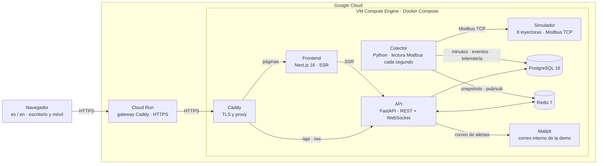

Son tres procesos de Python que comparten modelos y servicios, más el frontend:

- **API** (FastAPI): REST, WebSocket, autenticación, roles por planta y el cálculo del OEE.
- **Colector**: un solo proceso que cada segundo lee las ocho máquinas en paralelo con pymodbus,
  convierte disparos en piezas según las cavidades activas, escribe por lotes en PostgreSQL y deja
  el estado de cada máquina en Redis. Agregar una máquina es dar de alta un registro, no escribir
  un script.
- **Simulador**: un servidor Modbus con una máquina de estados por inyectora, reproducible por
  semilla. En una planta real se quita y se apuntan las máquinas de verdad.
- **Frontend** (Next.js, TypeScript): zona pública con SEO y zona privada con tiempo real por
  WebSocket.

PostgreSQL guarda el histórico. Redis guarda solo lo que cambia a cada segundo: el snapshot de cada
máquina, el canal de publicación hacia los navegadores, la caché de los resúmenes de días ya
cerrados y los contadores de intentos de login. Si Redis se cae, todo sigue funcionando más lento.

### Modelo de datos

Treinta y una tablas. Pongo columnas solo en las que importan para entender el flujo; el resto va
con sus relaciones.

```mermaid
erDiagram
  users ||--o{ plant_members : "pertenece a"
  plants ||--o{ plant_members : "tiene personal"
  users ||--o{ refresh_tokens : "sesiones"
  users ||--o{ password_reset_tokens : "recuperaciones"
  plants ||--o{ shifts : "turnos"
  plants ||--o{ production_lines : "líneas"
  plants ||--o{ machines : "máquinas"
  production_lines |o--o{ machines : "agrupa"
  machines ||--o| machine_board_positions : "posición en el plano"
  machines ||--o{ machine_variables : "tags Modbus"
  machines ||--o{ production_minutes : "minutos"
  machines ||--o{ production_samples : "muestras"
  machines ||--|| machine_checkpoints : "contadores absolutos"
  machines ||--o{ machine_events : "estados y paros"
  machines ||--o{ machine_telemetry : "telemetría"
  downtime_reasons |o--o{ machine_events : "motivo"
  users |o--o{ machine_events : "clasificó"
  plants ||--o{ products : "catálogo"
  plants ||--o{ molds : "catálogo"
  plants ||--o{ resins : "catálogo"
  plants ||--o{ employees : "personal de piso"
  users |o--o| employees : "cuenta opcional"
  products ||--o{ injection_recipes : "receta"
  molds ||--o{ injection_recipes : "receta"
  resins ||--o{ injection_recipes : "receta"
  resins ||--o{ resin_lots : "lotes"
  injection_recipes ||--o{ production_orders : "órdenes"
  production_orders ||--o{ production_runs : "corridas"
  machines ||--o{ production_runs : "corre en"
  molds ||--o{ production_runs : "molde montado"
  production_runs |o--o{ machine_telemetry : "contexto de la muestra"
  production_runs ||--o{ run_materials : "materiales"
  resin_lots ||--o{ run_materials : "lote consumido"
  production_runs ||--o{ run_employees : "personal asignado"
  employees ||--o{ run_employees : "asignación"
  production_lines ||--o{ line_downtimes : "paros de línea"
  downtime_reasons |o--o{ line_downtimes : "motivo"
  line_downtimes ||--o{ line_downtime_machines : "afecta a"
  machines ||--o{ line_downtime_machines : "afectada"
  plants ||--o{ alert_rules : "reglas"
  machines |o--o{ alert_rules : "regla por máquina"
  users ||--o{ notifications : "recibe"
  users ||--o{ watchlist : "sigue"
  machines ||--o{ watchlist : "seguida por"

  users {
    int id PK
    string username
    string email
    string password_hash
    string language
  }
  plants {
    int id PK
    string slug
    string name
    string timezone
    bool is_public
  }
  plant_members {
    int plant_id PK, FK
    int user_id PK, FK
    string role
  }
  shifts {
    int id PK
    int plant_id FK
    time start_time
    time end_time
    string days_of_week
  }
  machines {
    int id PK
    int plant_id FK
    int line_id FK
    string name
    string host
    int port
    int unit_id
    float ideal_cycle_s
  }
  machine_variables {
    int id PK
    int machine_id FK
    string code
    int address
    string data_type
    float scale
    float offset
  }
  production_minutes {
    int machine_id PK, FK
    datetime bucket_start PK
    int good
    int reject
    float run_s
    float idle_s
    float down_s
    float offline_s
  }
  machine_events {
    int id PK
    int machine_id FK
    string state
    string reason_code FK
    string comment
    int classified_by FK
    datetime started_at
    datetime ended_at
  }
  machine_telemetry {
    int machine_id PK, FK
    datetime sampled_at PK
    int run_id FK
    json values
  }
  injection_recipes {
    int id PK
    int product_id FK
    int mold_id FK
    int resin_id FK
    float ideal_cycle_s
    int active_cavities
  }
  production_runs {
    int id PK
    int order_id FK
    int machine_id FK
    int mold_id FK
    int active_cavities
    float ideal_cycle_s
    datetime started_at
    datetime ended_at
  }
  alert_rules {
    int id PK
    int plant_id FK
    int machine_id FK
    string type
    float threshold
    int duration_s
  }
  notifications {
    int id PK
    int user_id FK
    string type
    json payload
    datetime read_at
  }
```

El colector escribe en `production_minutes`, `production_samples`, `machine_checkpoints`,
`machine_events` y `machine_telemetry`. El OEE sale de los minutos, los turnos de la planta y el
estándar de la corrida vigente: `production_runs` congela cavidades y ciclo ideal para que cambiar
una receta después no reescriba la historia. Las alertas nacen en `alert_rules` y terminan en
`notifications`.

### Tecnologías

- Frontend: TypeScript estricto, Next.js 16 (App Router, SSR), React 19, next-intl, TanStack
  Query, React Hook Form + zod, Tailwind CSS 4, Recharts, exceljs, MSW para mocks. Vitest y
  Playwright para pruebas.
- Backend y colector: Python 3.12, FastAPI, SQLAlchemy 2 asíncrono con asyncpg, Alembic, Pydantic,
  PyJWT, argon2, pymodbus, Pillow, redis. uv, Ruff y pytest.
- Datos: PostgreSQL 16 y Redis 7.
- Infraestructura: Docker Compose, Caddy 2, Google Cloud (Compute Engine, Cloud Run, Artifact
  Registry, acceso por IAP).

---

## 3. Las partes, una por una

**Servidor.** Una VM `e2-medium` con Debian y Docker Compose. Solo Caddy publica puertos; base,
Redis, correo y simulador son internos. Cloud Run va por delante como entrada HTTPS. Cada versión
se empaqueta como un archivo con manifiesto SHA-256, se extrae en `/opt/oee-live/releases/<fecha>`
y se levanta con Compose; la anterior se queda para revertir. Antes de cada despliegue hago un
`pg_dump`. Los secretos viven en un solo archivo con permisos de root, fuera del repositorio.

**Base de datos.** PostgreSQL 16 con migraciones Alembic. Todo en UTC; los cortes por día y por
turno se calculan con la zona horaria de la planta. Solo puede haber un evento abierto por máquina
(índice único parcial). `machine_checkpoints` guarda los contadores absolutos para que, si el
colector se cae, no se inventen piezas al volver.

**Backend.** API REST con OpenAPI, WebSocket privado por sesión y público por planta, roles por
planta (propietario, supervisor, operador). El cálculo del OEE excluye el tiempo fuera de turno,
une turnos solapados, limita el rendimiento a 100 % y devuelve vacío cuando no hay con qué dividir,
en vez de inventar un cero. Los agregados de planta se hacen con acumulados, nunca promediando
porcentajes. 230 pruebas automatizadas.

**Simulador.** Ocho máquinas con perfiles de producción, falla, paro y rechazo. Es lo que alimenta
la demo; en planta no se usa.

**Frontend.** Zona pública con SEO (portada, tablero en vivo, detalle de máquina) y zona privada:
tablero en plano o tarjetas, máquinas, producción, paros, datos y configuración. El cliente del
API está tipado contra el contrato, la capa de tiempo real escribe los snapshots directo en la
caché, y los mocks implementan el mismo contrato para poder trabajar sin backend. 68 pruebas y un
recorrido automatizado de 35 pasos que corro antes de cada entrega.

---

## 4. Para entrar

- Aplicación: https://oee-live-keepcoding.cloud.run
- Usuario de consulta: `demo` · contraseña: `Demo1234!` (también aparece en la portada)
- Documentación del API: https://oee-live-keepcoding.cloud.run/api/v1/docs

La cuenta `demo` es operador: ve todo, no cambia nada. La demo se queda en línea una semana; si ya
no responde, en la sección 7 está cómo levantarla en local con Docker.

Si solo tienes cinco minutos: portada → tablero (plano) → clic en una máquina (línea de tiempo y
telemetría) → Paros → Datos y *Descargar Excel* → la campana con las notificaciones.

---

## 5. Pantallas

Capturas de la demo con la cuenta de consulta.

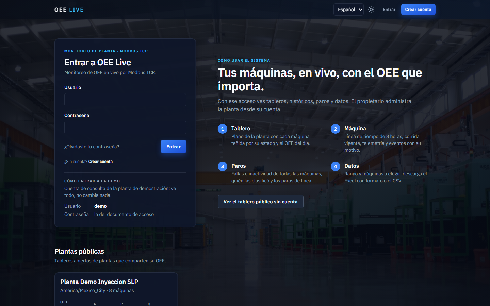

Portada: acceso, cuenta de demo y los cuatro pasos para usar el sistema.

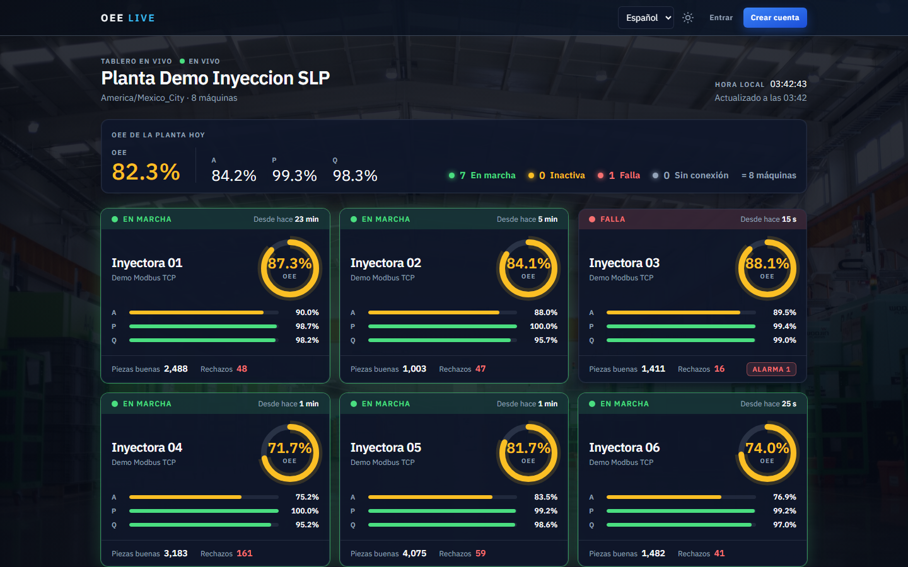

Lo que ve cualquiera sin cuenta. OEE de la planta hoy, máquinas por estado y una tarjeta por
máquina. Se renderiza en servidor y se actualiza por WebSocket.

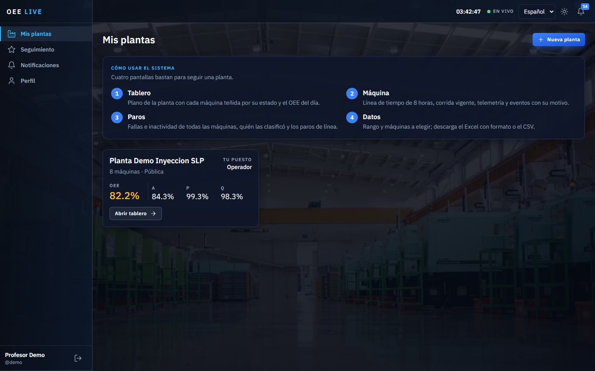

Las plantas de la cuenta, con el puesto en cada una y su OEE del día.

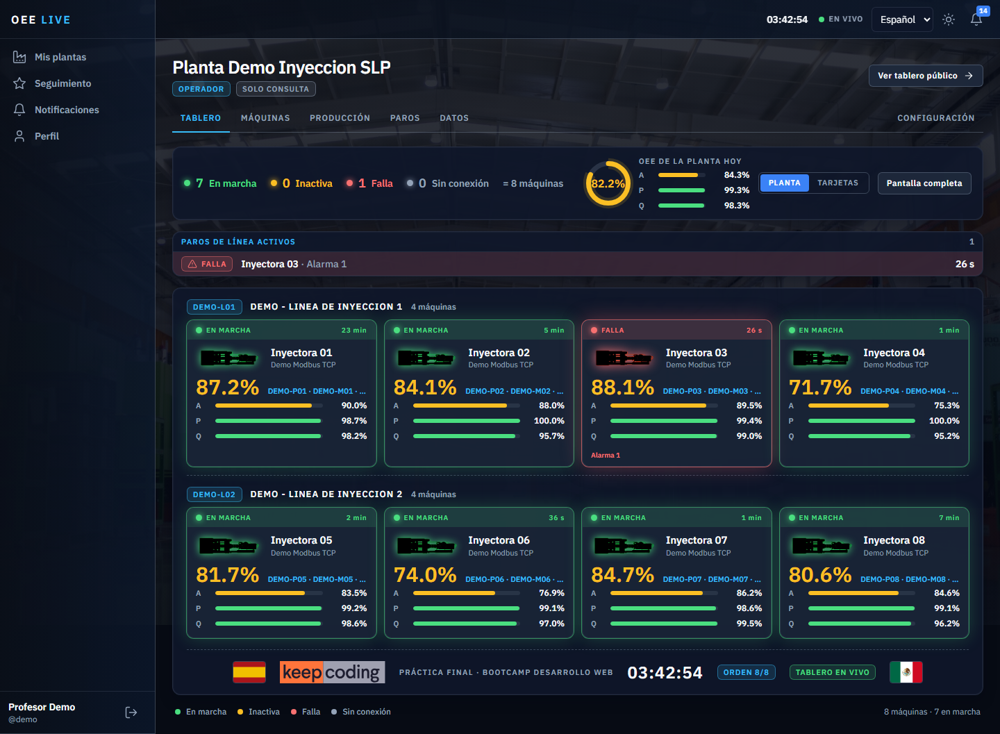

La pantalla que más trabajé. Una ficha por máquina agrupada por línea: barra de estado, silueta
teñida con ese estado, OEE del día con semáforo, barras de A, P y Q y la corrida vigente. Si hay
paros de línea aparece la franja roja arriba.

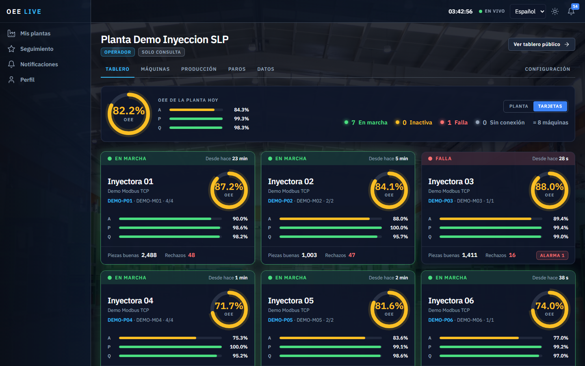

La misma información en tarjetas, para pantallas de piso.

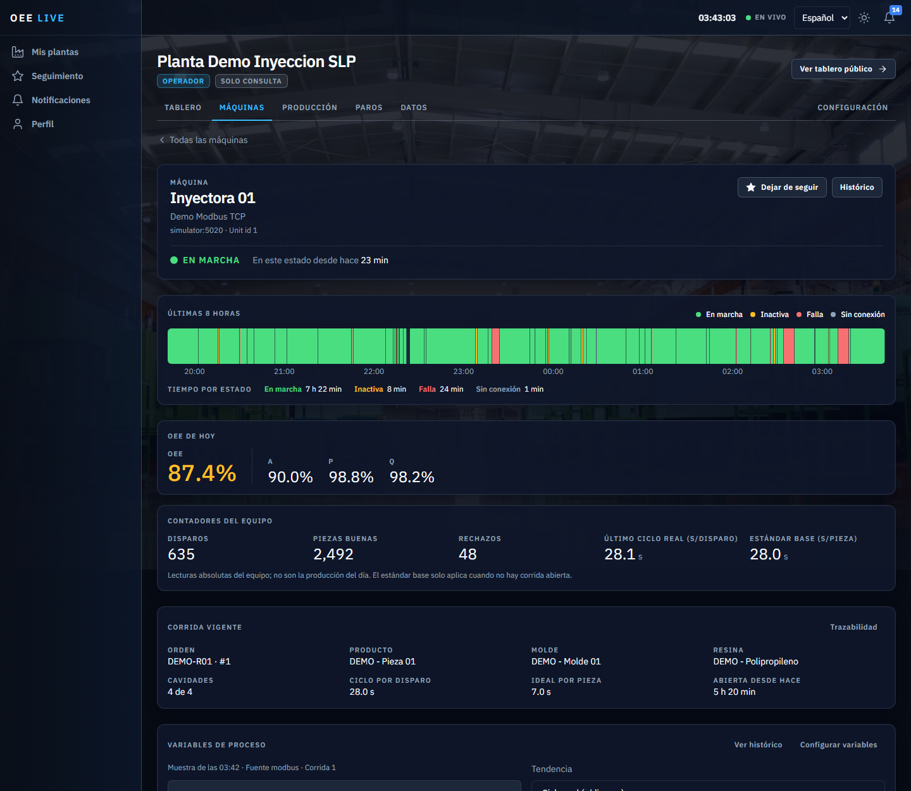

Línea de tiempo de 8 horas (el tooltip dice motivo y quién clasificó), OEE de hoy, contadores del
equipo, corrida vigente, variables de proceso en vivo, tendencia y eventos.

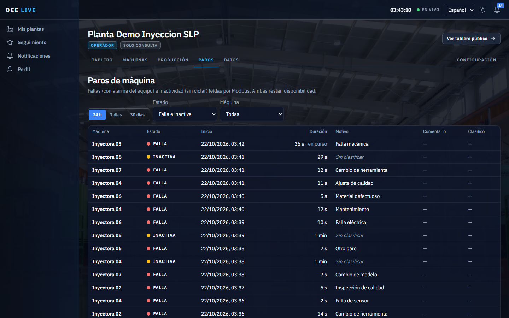

Fallas e inactividad de todas las máquinas, con motivo, comentario y quién clasificó; debajo, los
paros de línea. Las dos cosas restan disponibilidad.

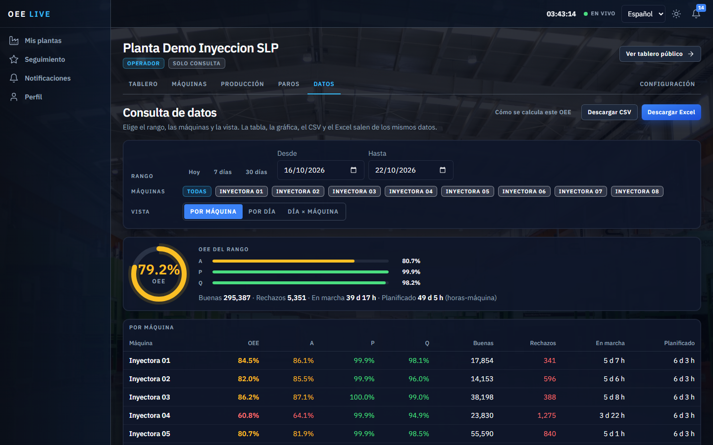
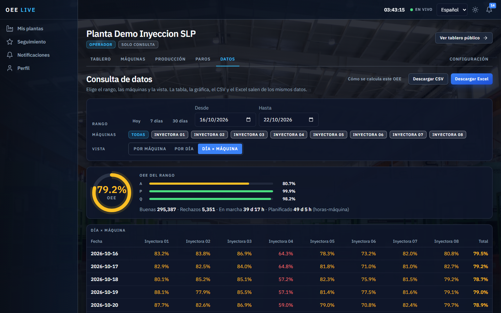

Rango, máquinas y tres vistas. La tabla, la gráfica, el CSV y el Excel salen de los mismos datos.
El Excel lleva portada, indicadores, tablas con semáforo y una hoja que explica el cálculo.

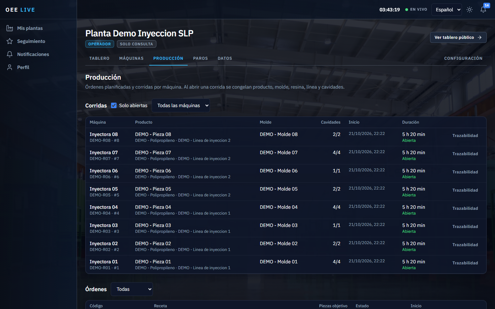

Órdenes y corridas de inyección. Al abrir una corrida se congelan producto, molde, resina y
cavidades.

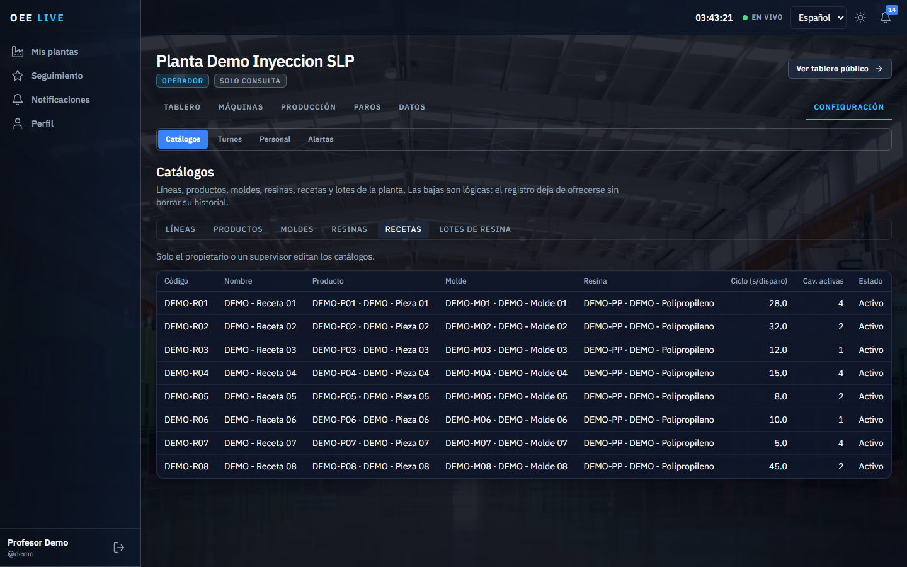

Configuración: catálogos, turnos, personal, alertas y planta. Solo propietario o supervisor editan.

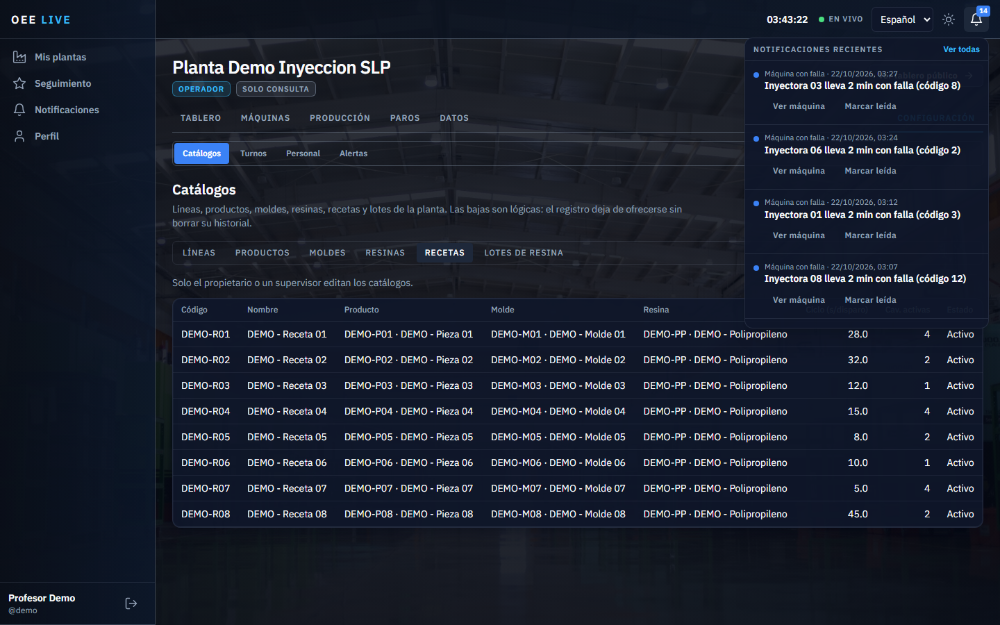

Las reglas de alerta generan notificaciones reales. Se leen desde la campana sin cambiar de
pantalla; por correo si la persona no está conectada.

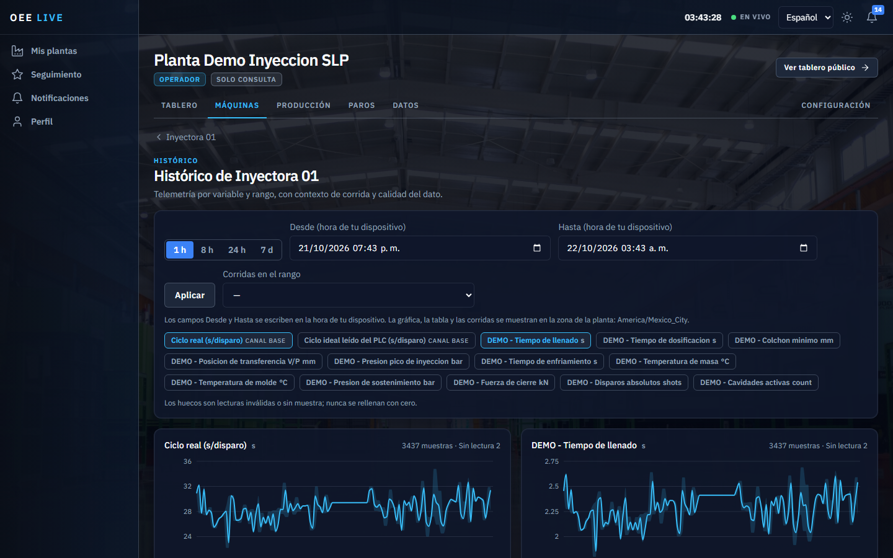

Variables de proceso por rango, con promedio, mínimo y máximo por intervalo y la calidad del dato.

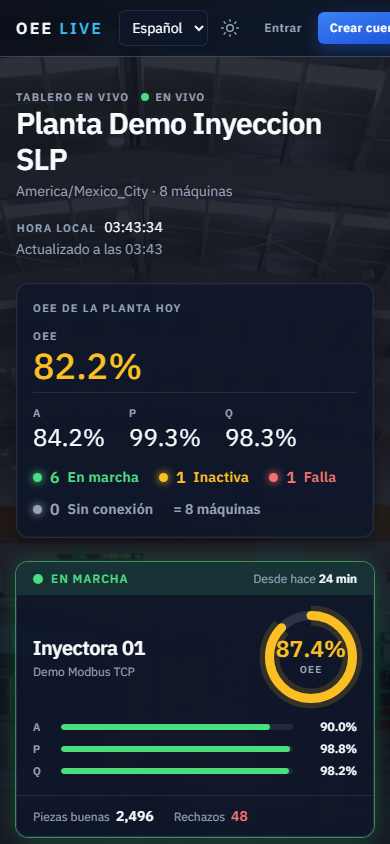

Todo es responsive; en el teléfono la zona privada usa barra inferior.

---

## 6. Seguridad

Lo que está hecho y se puede comprobar desde fuera:

- Contraseñas con Argon2. Access token de 15 minutos solo en memoria; refresh en cookie
  `HttpOnly`, `Secure`, `SameSite=Lax`, con rotación y familia revocable.
- Sin sesión, todo lo privado responde 401. Un recurso de otra planta responde 404, no se enumera.
  Un rol sin permiso, 403.
- Diez intentos de login por dirección y cincuenta por usuario cada diez minutos; después, 429.
  Lo del usuario lo subí a cincuenta porque la cuenta de demo es compartida y no quiero que un
  profesor la bloquee a otro.
- CORS solo para el origen del frontend. HSTS, `X-Frame-Options`, `nosniff`, `Referrer-Policy`,
  `Permissions-Policy`. Sin `x-powered-by`.
- Validación con Pydantic y zod. El CSV protege las celdas que empiezan con `=`. Las fotos se
  recodifican a WebP; no se sirve el archivo original.
- En la VM solo Caddy tiene puertos abiertos. Administración por SSH con IAP. Los registros
  excluyen las URLs del WebSocket porque llevan el token.
- `pnpm audit` limpio en producción.

Lo que no está y lo digo antes de que lo encuentren: no hay Content-Security-Policy (Next y las
gráficas usan estilos en línea y no quise romper la entrega por eso); la documentación del API es
pública a propósito; el token del WebSocket va en la URL porque así lo fijé en la especificación;
y la cuenta `demo` es pública por diseño, con permisos de solo lectura.

---

## 7. Ejecutarlo en localhost

**Con Docker** (lo recomendado). Desde esta carpeta:

```sh
cp .env.example .env
docker compose up --build -d
docker compose exec api python -m app.seed
```

Levanta todo y crea la planta de demostración. Cuenta local: `demo` / `Demo1234!`.
Aplicación en http://localhost:3000/es, API en http://localhost:8000/api/v1/docs, buzón de correo
en http://localhost:8025.

**Solo el frontend, sin backend.** Node 20.9+ y pnpm 12. Los mocks traen tres plantas y once
máquinas con simulación en vivo.

```sh
cd frontend
pnpm install
pnpm dev
```

Usuarios: `demo` / `Demo1234!` (propietario), `lmendez` / `Super1234` (supervisora), `cruiz` /
`Viewer1234` (operador).

**Backend sin contenedores.** Python 3.12 y uv; PostgreSQL, Redis y un SMTP accesibles según `.env`:

```sh
cd backend
uv sync --python 3.12
uv run alembic upgrade head
uv run python -m app.seed
uv run uvicorn app.main:app --host 127.0.0.1 --port 8000 --reload
uv run python -m app.collector      # en otra terminal
```

La referencia completa de variables y decisiones está en [docs/README-tecnico.md](docs/README-tecnico.md).

---

## 8. Qué me dejó el bootcamp

Hace dos años hice el bootcamp de Big Data en KeepCoding. Este lo tomé para reforzar desarrollo
web, porque en mi trabajo el MES lo levanté más por necesidad que por formación.

**Lo que reforcé del bootcamp**

- Pruebas desde el diseño (módulo de TDD). Antes probaba a mano en la planta; ahora las reglas del
  OEE, el CSV y el Excel nacieron con su prueba.
- Arquitectura en capas (módulo de backend): las reglas de negocio no saben de rutas ni de tablas.
- React: componentes, estado, hooks, rutas y formularios con validación (React fundamentos y
  avanzado).
- Backend con autenticación JWT y roles (backend avanzado).
- Configurar un servidor y desplegar (módulo de despliegue).

**Hasta dónde lo llevé en este proyecto**

- Las pruebas también en Python con pytest, y un recorrido automatizado que corro contra
  producción antes de entregar.
- La separación estricta de dominio e infraestructura, con mocks que implementan el mismo
  contrato del API; eso me dejó construir la pantalla cuando el API todavía no existía. Es la
  forma de trabajar que uso en el MES.
- Next.js con renderizado en servidor, caché con TanStack Query, snapshots de WebSocket escritos
  en la caché sin volver a pedir, i18n y accesibilidad.
- El backend en Python con FastAPI y contrato OpenAPI, refresh rotatorio, y un proceso aparte que
  lee las máquinas por Modbus.
- Docker Compose, proxy con TLS, versiones inmutables con respaldo y Cloud Run como entrada.

Lo que haría distinto con más tiempo: el histórico de telemetría sigue lento (las series de 8 horas
tardan varios segundos en una VM de 2 vCPU) y el CSV del servidor recalcula todo; lo resolví
cacheando los días cerrados y generando el CSV en el navegador, pero el cálculo de fondo merece
agregados precalculados.

---

## 9. Carpetas

```
09_proyecto-final/
  backend/        API FastAPI, colector, modelos, migraciones y pruebas
  frontend/       Next.js 16: zona pública, zona privada, mocks y pruebas
  simulator/      Simulador Modbus TCP de ocho máquinas
  scripts/gcp/    Aprovisionamiento de la VM, empaquetado, despliegue y respaldo
  docs/           especificacion.md (contrato), gcp-deployment.md (servidor), README-tecnico.md, images/
  docker-compose*.yml, Caddyfile*, .env.example
```

---

## 10. Estado

Desplegado en https://oee-live-keepcoding.cloud.run con la planta de demostración generando datos en
vivo. Se queda una semana; después, con Docker, levanta igual en cualquier equipo.
